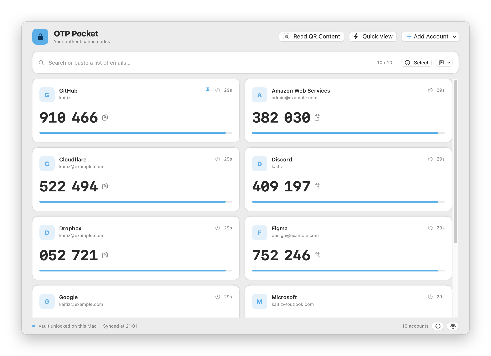
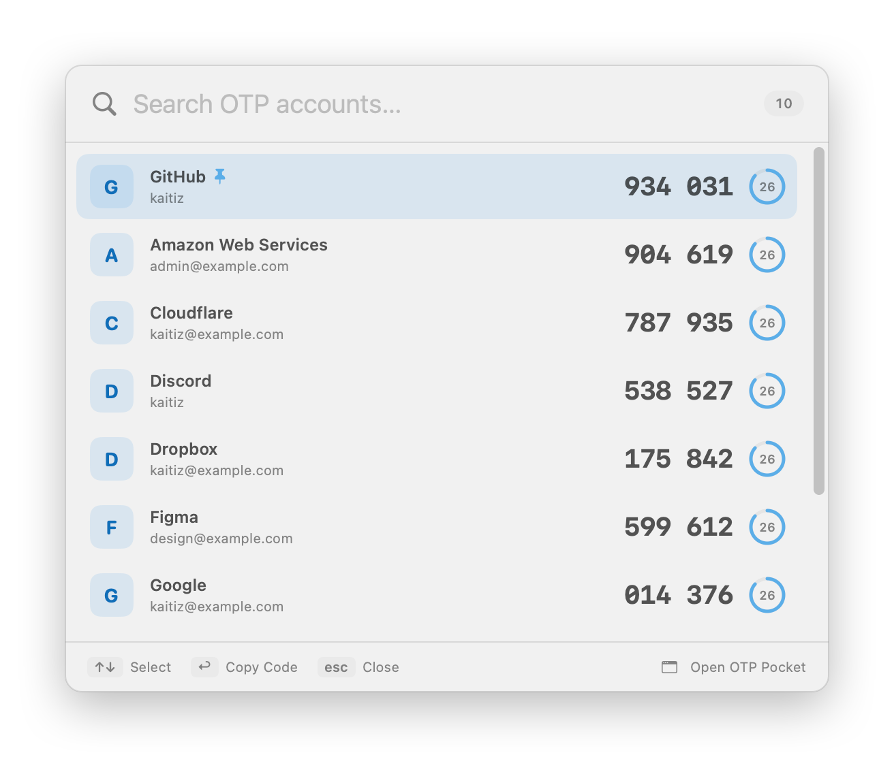
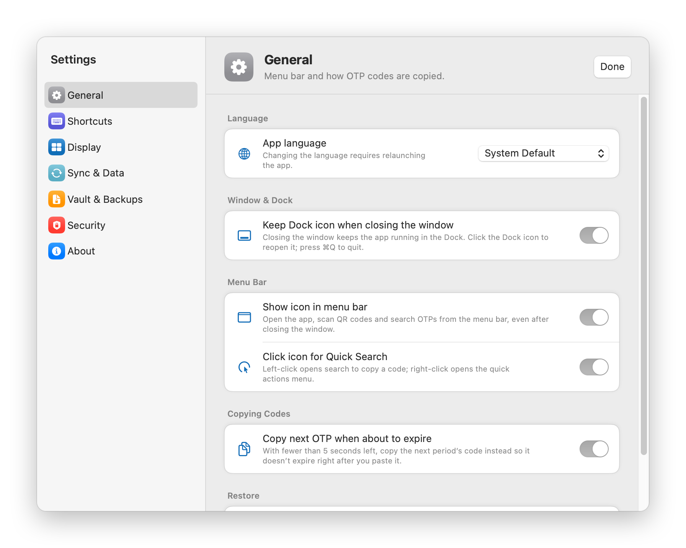

  

<h1 align="center">OTP Pocket</h1>

  A native two-factor authenticator for macOS. 
  <a href="https://github.com/Kaitiz/macos-otp-pocket/releases/latest"><b>Download the latest version</b></a>

<picture>
  <source media="(prefers-color-scheme: dark)" srcset="screenshots/main-dark.png">
  
</picture>

<a href="#english">English</a> · <a href="#tiếng-việt">Tiếng Việt</a>

---

## English

### Features
- **TOTP codes** — SHA1/SHA256/SHA512, 6–8 digits, custom periods.
- **Add accounts fast** — scan a QR code anywhere on screen, import images, or import backups from Aegis, 2FAS, Bitwarden, Proton, Raivo and more.
- **Quick search** — a global shortcut or the menu bar icon opens a search panel; press Enter to copy the code.
- **Encrypted sync** — one AES-256 encrypted vault in a hidden iCloud Drive folder (or any folder you choose), shared across your Macs.
- **Backups** — automatic daily backups, optional encrypted backups to Google Drive.
- **App Lock** — Touch ID or Mac password.
- **Private clipboard** — copied codes are hidden from clipboard managers and cleared after 60 seconds.
- **Automatic updates** from GitHub, light or dark appearance, in English or Vietnamese.

<picture>
  <source media="(prefers-color-scheme: dark)" srcset="screenshots/quick-search-dark.png">
  
</picture>
<picture>
  <source media="(prefers-color-scheme: dark)" srcset="screenshots/settings-dark.png">
  
</picture>

### Install
1. Download `OTP-Pocket-x.y.dmg` from [Releases](https://github.com/Kaitiz/macos-otp-pocket/releases/latest), open it and drag **OTP Pocket** onto the **Applications** shortcut.
2. The app isn't notarized by Apple, so macOS blocks it the first time. Open **System Settings → Privacy & Security**, scroll down and click **Open Anyway**.

Requires macOS 14 Sonoma or later (Apple Silicon and Intel).

---

## Tiếng Việt

### Tính năng
- **Mã TOTP** — SHA1/SHA256/SHA512, 6–8 chữ số, chu kỳ tuỳ ý.
- **Thêm tài khoản nhanh** — quét QR ở bất kỳ đâu trên màn hình, nhập từ ảnh, hoặc nhập backup từ Aegis, 2FAS, Bitwarden, Proton, Raivo…
- **Tìm nhanh** — phím tắt toàn hệ thống hoặc icon thanh menu mở ô tìm kiếm, nhấn Enter để chép mã.
- **Đồng bộ mã hoá** — một kho mã hoá AES-256 trong thư mục ẩn trên iCloud Drive (hoặc thư mục bạn chọn), dùng chung giữa các máy Mac.
- **Sao lưu** — tự sao lưu mỗi ngày, có thể sao lưu mã hoá lên Google Drive.
- **Khoá app** — bằng Touch ID hoặc mật khẩu máy Mac.
- **Clipboard riêng tư** — mã đã chép không bị trình quản lý clipboard lưu lại và tự xoá sau 60 giây.
- **Tự cập nhật** từ GitHub, giao diện sáng hoặc tối, tiếng Việt hoặc tiếng Anh.

<picture>
  <source media="(prefers-color-scheme: dark)" srcset="screenshots/quick-search-dark.png">
  
</picture>
<picture>
  <source media="(prefers-color-scheme: dark)" srcset="screenshots/settings-dark.png">
  
</picture>

### Cài đặt
1. Tải `OTP-Pocket-x.y.dmg` ở mục [Releases](https://github.com/Kaitiz/macos-otp-pocket/releases/latest), mở ra và kéo **OTP Pocket** vào lối tắt **Applications**.
2. App chưa được Apple notarize nên macOS chặn ở lần mở đầu. Vào **Cài đặt hệ thống → Quyền riêng tư & Bảo mật**, kéo xuống dưới và bấm **Vẫn mở**.

Yêu cầu macOS 14 Sonoma trở lên (Apple Silicon và Intel).
